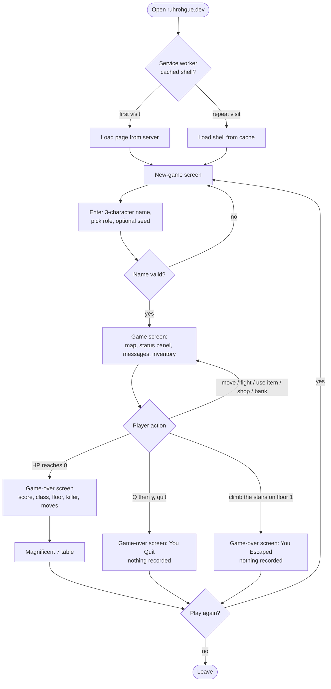
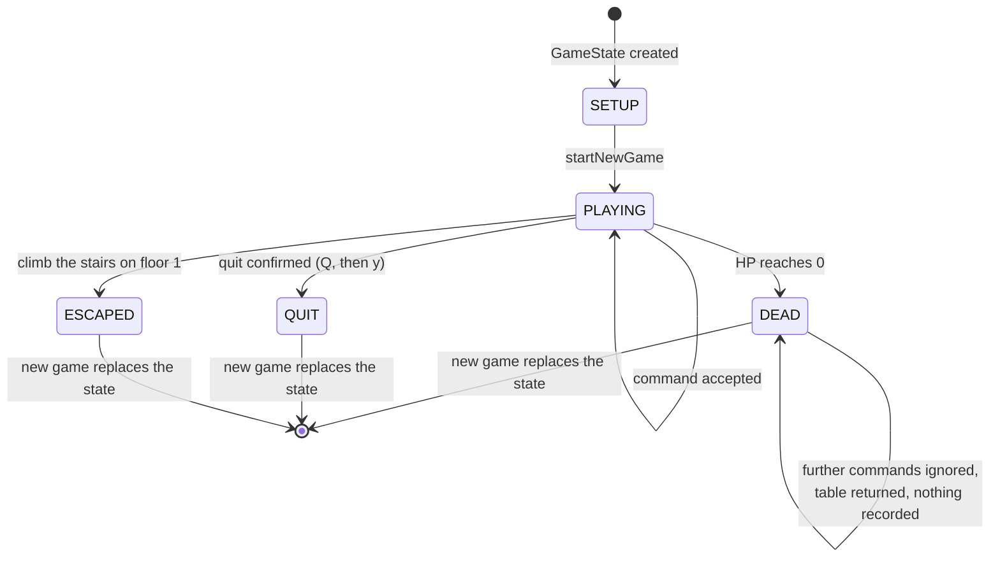
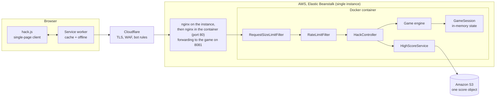
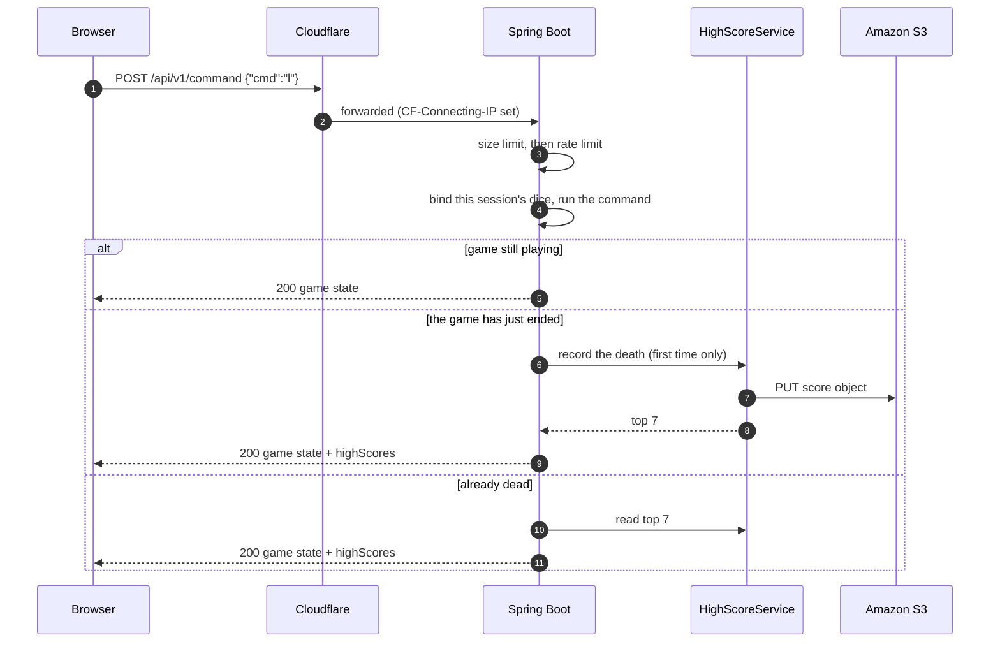

# App Flow and Design Brief — RuhRohgue Cloud Edition

| | |
|---|---|
| **Applies to** | v3.2.x |
| **Related** | [prd.md](prd.md) · [technical-requirements.md](technical-requirements.md) · [backend-schema.md](backend-schema.md) |

There are no Figma or Miro boards for this project. The diagrams below are the
design record. They are Mermaid, which GitHub renders natively, so they stay in
step with the code in review.

## 1. User journey

The whole game is one page. There is no routing, no login and no state in the
URL.

Banners appear on top of the game and sit above the modal layer so they stay
clickable:

- **Install banner**, offered by the browser when the PWA is installable.
- **Privacy banner**, shown once, dismissal remembered in local storage.
- **Offline banner**, shown while the browser reports no connection.

## 2. State management

### 2.1 Server-side game phases

The server holds the single source of truth. The client is stateless: it renders
what it receives and posts commands.

The score is recorded **once**, on the first response after the game becomes
`DEAD`. Only `DEAD` is recorded today: a game that ends in `QUIT` or `ESCAPED`
shows its game-over screen but adds nothing to the table. Commands that were already in flight at the moment of death still reach
the server; they receive the table but do not add to it
([TRK-013](https://github.com/roncproject/ruhrohgue/issues/20)).

### 2.2 Client states

| Condition | What the client does |
|---|---|
| No game yet | Shows the new-game screen |
| `phase = PLAYING` | Sends a command per keypress, redraws from the response |
| `phase = DEAD`, `ESCAPED` or `QUIT` | Stops sending keypresses and shows the game-over screen (`highScores` accompany `DEAD`) |
| Network failure | Offline banner; keypresses are queued and replayed when the connection returns |
| Tab hidden then revealed | Calls `GET /api/v1/state` to resynchronise |
| Rate limited (`429`) | Retries once after the interval in `Retry-After`, then drops the keypress quietly |

Session scope: one browser session is one game. Two tabs in the same browser
share it; two different browsers play two independent games, each with its own
random-number stream.

## 3. System architecture

### 3.1 Components

### 3.2 Request and response loop

Every action is a small JSON request. All endpoints are under `/api/v1`.

### 3.3 Start-up

On start, `HighScoreService` reads the score object once from S3 into memory. A
missing object is treated as an empty table. A read error is logged and the
table starts empty, so a storage problem cannot stop the game from booting.

### 3.4 Failure behaviour

| Failure | Result |
|---|---|
| S3 unreachable at start | Logged; the table starts empty and the next save will try again |
| S3 write fails | Logged; the game continues, the entry remains in memory until restart |
| Instance restarts | Games in progress are lost; the score table is reloaded from S3 |
| Rate limit exceeded | `429` with `Retry-After` |
| Oversized body | `413` |
| Invalid player name | `400` with `error: invalid_name` |

## 4. Design principles

- **Server authoritative.** The browser never decides an outcome.
- **One-shot UI signals.** Overlays such as shops and the look command are driven
  by a transient `signal` field that is cleared when read, so a state refresh
  never replays an old overlay.
- **Reproducible.** The same seed produces the same dungeon, items and monsters.
- **Small, boring operations.** One instance, one object in storage, one JAR.
- **Fail soft.** A storage hiccup should degrade the score table, not the game.
