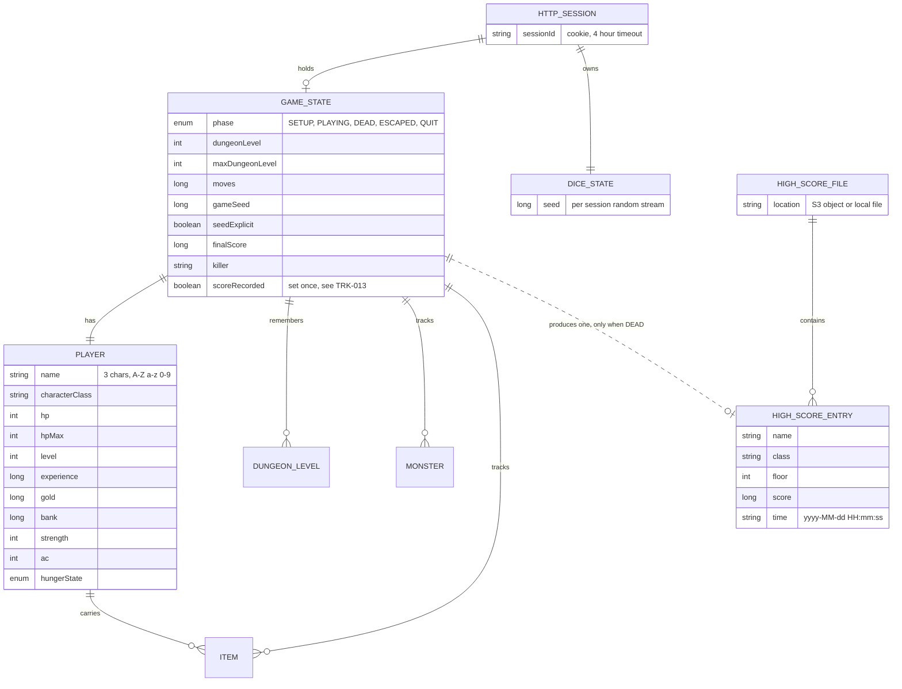

# Backend Schema and Implementation Plan — RuhRohgue Cloud Edition

| | |
|---|---|
| **Applies to** | v3.2.x |
| **Related** | [prd.md](prd.md) · [technical-requirements.md](technical-requirements.md) · [architecture-flow.md](architecture-flow.md) |

RuhRohgue has **no database**. There are two kinds of data:

1. **Game state**, held in server memory, one per browser session, thrown away
   when the session ends or the app restarts.
2. **High scores**, the only durable data, stored as one small file (an object in
   Amazon S3 in production, a file on disk locally).

## 1. Data model



Notes:

- Only `HIGH_SCORE_ENTRY` is persisted. Everything else exists only in memory.
- The diagram shows the entities that matter for the API. `GAME_STATE` and
  `PLAYER` hold many more fields, listed in `GameState.java` and `Player.java`.
- `GAME_STATE` produces a high-score entry on death, at most once. Quitting or
  escaping the dungeon (climbing out on floor 1) ends the game but records
  nothing.

## 2. Score file format

JSON Lines: one JSON object per line, UTF-8, newline separated. It can be read
and edited with any text editor.

```json
{"name":"ABC","class":"Fighter","floor":3,"score":208,"time":"2026-10-21 19:45:06"}
```

| Field | Type | Notes |
|---|---|---|
| `name` | string | Exactly three letters or digits |
| `class` | string | One of the roles in §4 |
| `floor` | integer | Deepest dungeon level reached |
| `score` | integer | Final score |
| `time` | string | Server local time, `yyyy-MM-dd HH:mm:ss` |

Rules applied by `HighScoreService`:

- Sorted by score, highest first.
- At most **100** records are kept; the table shown to players is the top **7**.
- A record identical in every field to one already stored is ignored.
- Lines that cannot be parsed are skipped when loading.

### Storage back ends

| Store | Selected by | Behaviour |
|---|---|---|
| `S3ScoreStore` | `SCORES_STORE=s3` plus a bucket | The whole table is one object, rewritten on every recorded death. Survives redeploys and instance replacement |
| `FileScoreStore` | default | Writes a temporary file, then replaces the target, so a crash cannot leave a half-written table. In the container's temp directory this is wiped on every deploy: development only |

Both implement the `ScoreStore` interface (`readLines`, `writeLines`,
`deleteAll`, `describe`), so the service does not care which one it has.

### Concurrency

- Within one app instance, a read/write lock guards the table.
- An S3 `PutObject` replaces the object atomically for one writer, but two
  writers would overwrite each other (last write wins). That cannot happen with
  one instance, which is why the deployment is single-instance.
- If a second instance is ever needed, the table must stop being cached at
  startup, and writes should become conditional on the object's ETag. That is
  deliberately not built yet.

## 3. API endpoint matrix

All game endpoints take and return JSON. Sizes are limited to 1024 bytes.

| Method | Route | Request body | Success response | Errors |
|---|---|---|---|---|
| `GET` | `/` | | HTML shell | |
| `POST` | `/api/v1/new` | `{"name":"ABC","role":"Fighter","seed":"42"}`; `role` and `seed` optional | `200` game state | `400` `{"error":"invalid_name","message":…}`; `413`; `429` |
| `POST` | `/api/v1/command` | `{"cmd":"l"}` | `200` game state; includes `highScores` once the game is `DEAD` | `413`; `429`; `200` `{"error":"no game"}` before a game exists |
| `GET` | `/api/v1/state` | | `200` current game state | `200` `{"error":"no game"}` |
| `GET` | `/dev/scores` | | `200` JSON array, top 7 | |
| `DELETE` | `/dev/scores` | header `X-Admin-Token` | `200` text | `401` if the token is missing or wrong, or no token is configured |
| `GET` | `/actuator/health` | | `200` `{"status":"UP"}` | |
| `GET` | `/robots.txt`, `/sitemap.xml` | | text / XML | |

Notes:

- A game session is identified by the session cookie, not by anything in the
  body.
- `role` is matched case-insensitively against the allow-list and **falls back
  to Fighter** when blank or unknown. `name` is the exception: an invalid name is
  rejected, not rewritten.
- A blank or non-numeric `seed` means a random game, not an error.
- `/dev/scores` is open for reading. It exposes only what the table already
  shows to every player.

### Game state response (abridged)

| Key | Meaning |
|---|---|
| `phase` | `SETUP`, `PLAYING`, `DEAD`, `ESCAPED` or `QUIT` |
| `player` | Position, HP, level, experience, gold, bank, strength, AC, hunger, status flags, name, class |
| `map`, `monsters`, `items`, `gold`, `traps` | What the player can currently see or remember |
| `inventory` | Items by slot letter; `a` is the first inventory slot |
| `messages`, `topMsg` | The message log |
| `signal` | One-shot UI control, cleared once read |
| `dlevel`, `maxFloor`, `moves`, `score`, `killer` | Run summary |
| `seed`, `seedFixed` | The seed, and whether the player chose it |
| `highScores` | Top 7; present only when `phase` is `DEAD` |

## 4. Reference data

- **Roles:** Fighter, Cave-man, Tourist, Wizard, Knight, Speleologist.
- **Player name:** `^[a-zA-Z0-9]{3}$`.
- **Limits:** top 7 shown, 100 retained, 600 requests per 60 s per client, 1024
  byte request bodies, 4 hour session timeout.

## 5. Migration and operations plan

There are no schema migrations to run, because there is no database. These are
the steps that matter when the data or its location changes.

### 5.1 First-time production setup of the S3 store

1. Create a private bucket in the application's region, with public access
   blocked.
2. Give the instance profile read, write and delete on the one object key and
   `s3:ListBucket` on the bucket, and nothing wider.
3. Set `SCORES_STORE`, `SCORES_S3_BUCKET` and `SCORES_S3_REGION` as environment
   properties. Check the start-up log: it prints the store location it chose.
4. Play one game to the end and confirm the object appears and `GET /dev/scores`
   returns it.
5. Restart the app server and confirm the score is still there.

### 5.2 Changing the record format

Records are one JSON object per line and the parser tolerates missing fields. To
add a field:

1. Write it in `HighScoreEntry.toJson()` and read it in `fromJson()`, giving the
   reader a sensible default so existing lines still load.
2. Release. Old lines keep working; new lines carry the field.
3. Do not rewrite the stored file by hand unless you also restart the app, since
   the table is held in memory.

### 5.3 Clearing or restoring the score table

- **Clear:** download the object first if you want a backup, delete it, then
  restart the app server. Deleting without a restart is undone at the next
  recorded death.
- **Restore or hand-edit:** upload the edited file to the same key, then restart.
- **Local development:** point `SCORES_DIR` and `SCORES_FILE` at an editable path.

### 5.4 Moving off a single instance

Not planned. If it is ever needed, first read the "Concurrency" section above:
the in-memory table and last-write-wins writes must be addressed before a second
instance is added.
